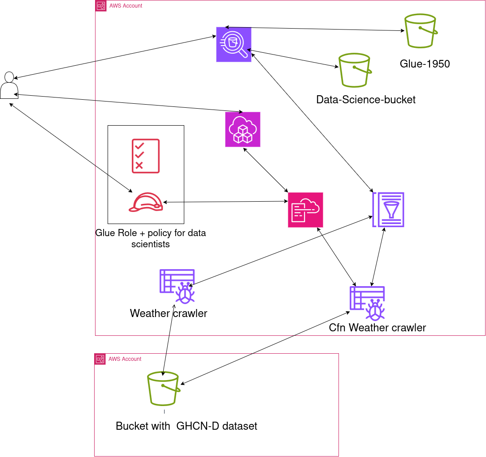

# AWS ETL Data Lake Analytics

An AWS data engineering project that processes historical weather data using Amazon S3, AWS Glue, and Amazon Athena. The workflow includes data cataloging, ETL transformation, Parquet storage, SQL analytics, infrastructure as code, and IAM access control.

The project uses the NOAA Global Historical Climatology Network Daily (GHCN-D) dataset to demonstrate how cloud services can be used to prepare and analyze historical weather observations.

## Project Objectives

- Catalog source data using AWS Glue Crawlers and the Glue Data Catalog.
- Explore and query datasets using Amazon Athena.
- Transform raw weather data into Parquet format.
- Filter records to a selected date range and retain relevant columns.
- Analyze annual average maximum-temperature observations using SQL.
- Deploy Glue resources using AWS CloudFormation.
- Review IAM permissions and validate access to Glue resources.
- Document query execution times and data-scanning statistics.

## Architecture

The following diagram was provided as part of the AWS lab materials and illustrates the data-processing workflow.



### Workflow

1. **Amazon S3:** Stores the source NOAA GHCN-D dataset.
2. **AWS Glue Crawler:** Discovers the source dataset schema.
3. **AWS Glue Data Catalog:** Stores metadata about the dataset.
4. **Amazon Athena:** Queries the source data and performs transformations.
5. **Amazon S3:** Stores the transformed dataset in Parquet format.
6. **Amazon Athena:** Executes analytical queries against the transformed data.
7. **AWS CloudFormation:** Defines and deploys Glue resources.
8. **AWS IAM:** Controls access to AWS resources.

> **Note:** The diagram is lab-provided architecture documentation. The implementation details and screenshots in this repository document the work completed in the project.

## Technologies Used

| Technology | Purpose |
|---|---|
| Amazon S3 | Stores raw and transformed datasets. |
| AWS Glue | Discovers and catalogs source data. |
| AWS Glue Data Catalog | Maintains table metadata. |
| Amazon Athena | Executes SQL queries against data in S3. |
| Apache Parquet | Stores transformed data in a columnar format. |
| AWS CloudFormation | Defines and deploys AWS resources as code. |
| AWS IAM | Manages permissions and resource access. |
| AWS CLI | Inspects and validates AWS resources. |
| SQL | Transforms, validates, and analyzes weather data. |
| Git and GitHub | Version control and project documentation. |

## Dataset

**Dataset:** NOAA Global Historical Climatology Network Daily (GHCN-D)

**Source:** [NOAA GHCN-D on Amazon S3](https://registry.opendata.aws/noaa-ghcn/)

The dataset contains historical daily weather observations collected from weather stations around the world.

The source files used in the lab are stored under:

`s3://noaa-ghcn-pds/csv/by_year/`

### Data Catalog

| Property | Value |
|---|---|
| Database | `weatherdata` |
| Source table | `by_year` |
| Transformed table | `late20th` |
| Analysis view | `tmax` |
| Date range | 1950–2015 |
| Output format | Parquet |
| Selected columns | `date`, `type`, `observation` |

The source table schema was reviewed and column names were updated to improve readability and usability in SQL queries.

Examples of the updated column names include:

| Original column | Updated column |
|---|---|
| `id` | `station` |
| `element` | `type` |
| `data_value` | `observation` |
| `m_flag` | `mflag` |
| `q_flag` | `qflag` |
| `s_flag` | `sflag` |
| `obs_time` | `time` |

## Implementation

### 1. Catalog Source Data with AWS Glue

An AWS Glue Crawler was configured to discover the schema of the source dataset in Amazon S3.

The crawler populated the AWS Glue Data Catalog with metadata for the source table.

The schema was reviewed and adjusted before the data was queried through Amazon Athena.

### 2. Explore the Source Data

The source table was inspected using Athena:

```sql
SELECT *
FROM weatherdata.by_year
LIMIT 10;
```

This query returned sample records from the cataloged dataset.

### 3. Transform Data into Parquet

A CTAS (Create Table As Select) query was used to create a filtered dataset containing selected columns and records from 1950 through 2015.

```sql
CREATE TABLE weatherdata.late20th
WITH (
    format = 'PARQUET',
    external_location = 's3://<your-bucket-name>/lab3'
) AS
SELECT
    date,
    type,
    observation
FROM weatherdata.by_year
WHERE date / 10000 BETWEEN 1950 AND 2015;
```

Replace `<your-bucket-name>` with the appropriate S3 bucket name when executing the query.

The transformation:

- Filters records to the selected date range.
- Retains only the columns required for the analysis.
- Writes the output in Parquet format.
- Registers the resulting table in the Glue Data Catalog.

### 4. Validate the Transformed Dataset

The output table was inspected to verify that the transformed data was available.

```sql
SELECT *
FROM weatherdata.late20th
LIMIT 10;
```

### 5. Create and Inspect the TMAX View

A view was created to select maximum-temperature observations.

```sql
CREATE VIEW TMAX AS
SELECT
    date,
    observation,
    type
FROM weatherdata.late20th
WHERE type = 'TMAX';
```

The view was inspected using:

```sql
SELECT *
FROM weatherdata.tmax
LIMIT 10;
```

The `TMAX` element identifies maximum-temperature observations.

### 6. Analyze Annual Average Maximum Temperatures

The final query calculates annual average maximum-temperature observations.

```sql
SELECT
    date / 10000 AS year,
    AVG(observation) / 10 AS max
FROM weatherdata.tmax
GROUP BY date / 10000
ORDER BY date / 10000;
```

The query groups records by year, calculates the average observation, converts the value from tenths of a degree Celsius to degrees Celsius, and orders the results chronologically.

## Query Execution Results

The following measurements were recorded during execution in Amazon Athena.

| Operation | Execution time | Data scanned |
|---|---:|---:|
| Create filtered Parquet dataset | 30.184 seconds | 106.19 GB |
| Annual temperature analysis | 9.714 seconds | 2.36 GB |

The annual temperature analysis completed in approximately 9.7 seconds and scanned 2.36 GB of data.

These figures are the recorded results of two different queries. They should not be interpreted as a controlled benchmark of Parquet against CSV because the queries perform different workloads.

The project demonstrates the use of columnar storage, column selection, date filtering, and SQL analytics in an AWS data-processing workflow.

## Infrastructure as Code

AWS CloudFormation was used to define and deploy the Glue database and crawler.

Template location:

[`infrastructure/gluecrawler.cf.yml`](infrastructure/gluecrawler.cf.yml)

### Validate the CloudFormation Template

```bash
aws cloudformation validate-template \
  --template-body file://gluecrawler.cf.yml
```

### Deploy the Stack

```bash
aws cloudformation create-stack \
  --stack-name gluecrawler \
  --template-body file://gluecrawler.cf.yml \
  --capabilities CAPABILITY_NAMED_IAM
```

Run the commands from the directory containing the template, or adjust the file path accordingly.

Deployment requires a configured AWS CLI environment and sufficient permissions.

### Verify the Glue Crawler

List available crawlers:

```bash
aws glue list-crawlers
```

Inspect the deployed crawler:

```bash
aws glue get-crawler \
  --name cfn-crawler-weather
```

These commands can be used to inspect the crawler configuration, database, and S3 target.

## IAM Access Control

The project included reviewing the `Policy-For-Data-Scientists` IAM policy to understand permissions for AWS Glue resources.

The access-validation workflow included examining whether the configured identity could:

- List Glue crawlers.
- Retrieve crawler configuration.
- Start an authorized crawler.

The AWS CLI was used to inspect resource access and validate the configured permissions.

Only treat an access test as successful when the corresponding command output confirms success.

## Screenshots and Evidence

The `screenshots/` directory contains visual evidence of the implementation.

| Screenshot | Description |
|---|---|
| `01-glue-crawler-success.png` | AWS Glue crawler status. |
| `02-glue-data-catalog-schema.png` | Data Catalog schema. |
| `03-athena-source-data.png` | Source data queried in Athena. |
| `04-athena-parquet-creation.png` | CTAS transformation and execution results. |
| `05-athena-query-optimization.png` | Athena query execution statistics. |
| `06-annual-temperature-analysis.png` | Annual temperature analysis results. |
| `07-cloudformation-template.png` | CloudFormation template. |
| `08-cloudformation-deployment.png` | CloudFormation deployment evidence. |
| `09-cli-crawler-verification.png` | Glue crawler inspected using the AWS CLI. |
| `10-iam-policy-review.png` | IAM policy review. |
| `11-iam-user-access-test.png` | IAM access-validation commands and results. |

Only screenshots that are actually present in the repository should be listed here. Update the filenames and descriptions to match your uploaded files.

## Repository Structure

```text
aws-etl-data-lake-analytics/
├── README.md
├── sql/
│   └── weather_analysis.sql
├── infrastructure/
│   └── gluecrawler.cf.yml
├── architecture/
│   └── aws-etl-architecture.png
└── screenshots/
    ├── 01-glue-crawler-success.png
    ├── 02-glue-data-catalog-schema.png
    ├── 03-athena-source-data.png
    ├── 04-athena-parquet-creation.png
    ├── 05-athena-query-optimization.png
    ├── 06-annual-temperature-analysis.png
    ├── 07-cloudformation-template.png
    ├── 08-cloudformation-deployment.png
    ├── 09-cli-crawler-verification.png
    ├── 10-iam-policy-review.png
    └── 11-iam-user-access-test.png
```

## Key Learnings

Through this project, I gained practical experience with:

- Cataloging datasets stored in Amazon S3 using AWS Glue.
- Querying large datasets using Amazon Athena.
- Transforming selected records into Parquet format.
- Writing SQL queries for data validation and analysis.
- Analyzing historical temperature observations.
- Deploying AWS resources using CloudFormation.
- Reviewing IAM policies and resource permissions.
- Using the AWS CLI to inspect cloud resources.
- Documenting query execution results and implementation steps.

## Cleanup

AWS resources may incur charges depending on the services and storage used.

After completing the project, review the resources created during the lab and remove those that are no longer required.

If the CloudFormation stack was created specifically for this project and is no longer needed, it can be deleted using:

```bash
aws cloudformation delete-stack \
  --stack-name gluecrawler
```

Check the stack status and review resources that may exist outside the stack before considering cleanup complete.

## Security Considerations

- Never commit AWS access keys, secret keys, session tokens, or other credentials.
- Redact credentials and sensitive account details from screenshots.
- Review CloudFormation templates for account-specific ARNs before publishing.
- Do not publish temporary credentials from an educational lab.
- Document environment-specific S3 paths appropriately.

## Author

**Umair Farooq**

- GitHub: [umair9211](https://github.com/umair9211)
- LinkedIn: [Umair Farooq](https://linkedin.com/in/umair-farooq-6ab9b2201)

---

*This project was completed as a hands-on exercise in AWS data engineering and cloud infrastructure management.*
